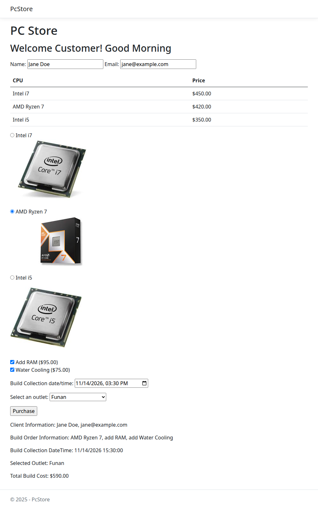

# PC Store

An ASP.NET Core Razor Pages ordering page for a computer shop. The customer picks a CPU and extras, chooses when and where to collect the build, and the page works out the total.

| Item | Price |
|---|---|
| Intel i7 | $450.00 |
| AMD Ryzen 7 | $420.00 |
| Intel i5 | $350.00 |
| Add RAM | $95.00 |
| Water cooling | $75.00 |

## Features

- Choose one CPU, each shown with a product photo. Intel i7 is selected by default.
- Add RAM and water cooling as optional extras.
- Pick a collection date and time, and one of five outlets: Sim Lim Square, Funan, VivoCity, Harbourfront Center or Plaza Singapura.
- Name and email are required. If either is missing, the page lists the error messages at the top and does not take the order. This is checked on the server.
- After Purchase, the page shows the customer details, the build (CPU plus any extras), the collection time, the outlet and the total cost. The total is the CPU price plus the extras.
- The greeting says Good Morning or Good Afternoon depending on the time.



## Running it

You need the .NET 8 SDK.

```
cd PcStore
dotnet run
```

Then open http://localhost:5236. You can also open `PcStore.sln` in Visual Studio and run it.
